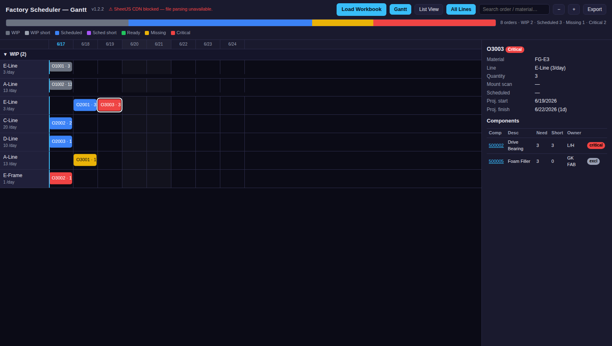

# Factory Scheduler — Gantt

A single-file HTML application that reads a production-scheduling Excel workbook
and renders an interactive, SLOC-aware, WIP-tracking Gantt with lead-time
analysis, ripple re-sequencing, a flat List View, and Excel export. No backend,
no build step — open `index.html` in a browser and drop in your workbook.



## Usage

1. Open `index.html` in any modern browser (it loads [SheetJS] from a CDN; if
   the CDN is blocked a warning appears and file parsing is disabled).
2. Drag a workbook onto the window, or click **Load Workbook**.
3. Explore: toggle **Gantt** / **List View**, zoom (**+ / −**), filter with
   **Search**, switch **All Lines** ↔ priority line (`71E`), click a bar/row for
   the detail panel, click a component for its per-SLOC inventory, and drag bars
   or rows to re-sequence (status changes flash — the "ripple").
4. **Export** writes an `.xlsx` with *List View*, *7-Day Shortages*, and
   *Call Back List* sheets.

## Expected workbook (the "Mount Orders Template")

Data may come from SAP and/or EOP; column matching is alias-tolerant and
case-insensitive. Worksheets:

| Tab | Required | Key columns |
|-----|----------|-------------|
| Orders | ✅ | Order, Material, MRP ctrlr, Target qty, Unit, Bsc start, Basic fin., ScheduledTimeStamp, MountScanTime, Sequence |
| BOM | ✅ | Order, Material, Material Description, Open Quantity, UOM |
| On Hand | ✅ | Material, SLoc, Unrestricted |
| Units Per Day | | MRP Controller, Line, Units Per Day |
| Shifts | | (shift), Start Time, Stop Time |
| Component Exclusions | | Material |
| SLOC Lead Times | | SLOC, Lead Time, Description, Include/Exclude Inventory? |
| Critical Components | | Material |
| Master Data | | Material, MRP Controller, Procurement Type · MRP, Owner |

Missing **Orders / BOM / On Hand** is a blocking error; other missing tabs raise
a warning with a **Proceed Anyway** option.

### How the data drives the schedule

- Orders are classified **WIP** (has MountScanTime) → **Scheduled** (has
  ScheduledTimeStamp) → **Unscheduled**, then placed in a global consumption
  sequence (WIP first).
- Available inventory is the sum of On-Hand `Unrestricted` across **Include**
  SLOCs only (per *SLOC Lead Times*); inventory in Exclude SLOCs is ignored.
- Components are consumed in sequence; shortages are flagged. Materials in
  **Critical Components** turn an order **red**; materials in **Component
  Exclusions** never flag a shortage.
- **Master Data** supplies each component's Procurement Type (E=in-house,
  F=purchased, X=both) and an MRP-Controller → Owner attribution used in the
  Call Back List.
- Projected start/finish come from each line's **Units Per Day** capacity over
  working days (weekends skipped).

Status colors: gray = WIP, blue/purple = scheduled (covered / short),
green = ready, yellow = missing (non-critical), red = critical.

## Development

```sh
npm install            # dev deps: xlsx (sample generation) + puppeteer (tests)
npm run gen            # writes sample-data.xlsx
npm test               # generates the sample, then runs the headless self-test
```

`tools/gen-sample.mjs` builds a schema-exact sample workbook that exercises every
status path (coverage tiers, a critical shortage, an excluded component with no
inventory, and inventory parked in an Exclude SLOC). `tools/test.mjs` loads
`index.html` in headless Chromium, feeds it that workbook, and asserts the
computed statuses, summary counts, export contents, and ripple behavior.

[SheetJS]: https://sheetjs.com/
